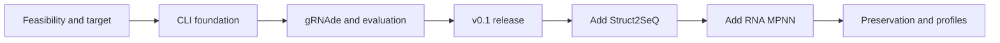

# RNA Sequence Design CLI: milestones and implementation tickets

Date: 2026-09-22 | Status: three-model CLI, combined ranking and explicit reconstruction implemented | Specification: [PRD](PRD.md)

Build a general RNA CLI from the official scientific implementations. Do not port the supplied prototype's logic. The first usable release accepts any supported RNA sequence, uses ViennaRNA MFE to predict its secondary target, redesigns the full sequence with gRNAde in 2D mode, and prefers local execution. Twort is one example fixture. Each additional model is a separate later release. Tertiary-structure input and explicit fixed-context reconstruction are now available; general region constraints and sequence-bias profiles remain later work. Existing TW ticket IDs are retained for continuity and have no runtime meaning.

Tickets have not been published to an external tracker. TW-001–TW-018 have implementation and engineering verification evidence; the human biology review within TW-015 remains pending. The second-model extension implements TW-017/TW-018 with a CPU Struct2SeQ adapter. The combined-run portion of TW-019 is implemented; its external-scoring and richer comparison-report work remain deferred. TW-020/TW-021 now implement explicit backbone mapping, the CPU NA-MPNN adapter, and mapped-segment reconstruction; TW-022–TW-027 remain deferred. Roles: **ENG** = software engineer; **ML** = engineer comfortable with model inference; **BIO** = biology collaborator. One person may fill multiple roles. Sizes S/M/L describe relative effort and uncertainty, not calendar promises.

## Implementation status, 2026-09-22

| Ticket | Engineering status and evidence |
|---|---|
| TW-001 | Implemented: generic canonical RNA input, original-byte snapshots, automatic target; 8/36/76/282/500 nt real fixtures |
| TW-002 | Verified local CPU stack: official pinned gRNAde, RNet and RNet-SS; ten real proposals per smoke fixture; see `evidence/release-results.json` |
| TW-003 | Frozen `oksp-target-ecs-cpq-v1`; 72 comparisons against pinned primary upstream scorer; `docs/SCORING.md` |
| TW-004 | Package, strict YAML schema, documented commands and exit codes; lightweight command tests |
| TW-005 | RNA/FASTA and pair parsing, crossing detection, invalid symbols, length boundaries; scientific unit tests |
| TW-006 | Real ViennaRNA MFE/partition function, separate target override, independent candidate folds; real pseudoknot override run |
| TW-007 | Sealed inputs/config, atomic batches, content IDs, generation events, immutable evaluation/selection records |
| TW-008 | Explicit pinned setup, hash/source checks, `models list`, `doctor`, separate local-inference verification metadata |
| TW-009 | Real upstream `test_2d` sampling with no fixed positions/reference bias; bounded quotas and recorded native perplexity |
| TW-010 | Raw RNet channels retained; versioned full-target ECS/CPQ score; upstream equivalence and failed-predictor tests |
| TW-011 | Separate RNet-SS checkpoint and pinned Hungarian decoder; pair/crossing metrics and null conventions tested |
| TW-012 | Real SIGINT/resume demonstration, committed-stage reuse, replay attempt accounting, wall-time/attempt bounds, exclusive run locks |
| TW-013 | Both Levenshtein outputs, composition gates, deterministic ranking and saved-score reselection implemented and audited |
| TW-014 | FASTA/CSV/JSONL, reference control, generation provenance and Markdown reports; export and reselection exercised on real runs |
| TW-015 | Engineering checks passed: 1,000 unique proposals scored, 100 selected; all candidate distances audited; real empty/override/recovery runs. **Human biology review pending**, not inferred from test results |
| TW-016 | Tested local setup and operational guide. Local CPU was sufficient; Linux/CUDA/Runpod recipe explicitly **unverified** |

Full measurements and limitations: [evidence](../evidence/README.md), [operations](IMPLEMENTATION.md).

## Roadmap and release gates

| Milestone | Deliverable | Exit gate | Dependencies |
|---|---|---|---|
| M0: Validate feasibility | Verified ViennaRNA -> gRNAde 2D path and RNet evaluation stack; local-versus-GPU decision | Real smoke inference across unrelated RNA fixtures and representative lengths, including the 282-nt Twort example; documented capability limits | None |
| M1: Build the CLI foundation | Inputs, target preparation, configuration, run artifacts | Validated construct/target can be saved and inspected without model inference | Target contract from M0 |
| M2: Complete the scientific path | gRNAde generation plus common RNet/RNet-SS evaluation | Real candidates have traceable predictions and can resume after interruption | M0, M1 |
| M3: Ship v0.1 | Filtering, ranking, exports, documentation, tested campaign | A bounded 1,000-proposal full-redesign campaign and biology-reviewable report | M2 |
| M4: Add Struct2SeQ | Second independent generator under the same CLI | Both families have matched evaluation and honest comparison reports | v0.1 |
| M5: Add RNA MPNN / 3D inputs | Mapped backbone input and third generator | No silent construct changes; real NA-MPNN output evaluated in full context | v0.1 and approved mapping; scheduled after M4 |
| M6: Add preservation controls | Fixed/mutable regions, calibrated profiles, diversity selection | Hard constraints hold for every selected candidate across supported adapters | Stable adapters; can start on gRNAde earlier if priorities change |

M0-M3 define the first release. M4-M6 do not block it. No UI milestone is committed; a future UI should use the established core and artifact contracts after the CLI proves useful.

The diagram is the recommended delivery order. M5 technically depends on the shared core and mapping, rather than Struct2SeQ's algorithm.

## M0 - Validate feasibility before committing to a runtime

### TW-001 - Establish general sequence input and automatic target prediction

**Priority:** P0 | **Size:** S | **Owner:** BIO + ML | **Depends on:** none | **PRD:** FR-01

Define sequence-only operation: each run accepts the user's RNA, uses ViennaRNA MFE to predict its secondary structure as the design target, and optionally accepts a secondary-structure override. Twort must not be a special input path. This ticket validates the agreed workflow; it does not reopen secondary versus tertiary scope.

Acceptance criteria:

- Record each input's hash, normalized sequence and length; biological context annotations are optional metadata.
- Default to a clearly labeled reference-MFE prediction; supplying an explicit target is optional and overrides target prediction for design.
- Confirm full-sequence redesign and canonical A/C/G/U chemistry for the initial configuration; no hidden fixed positions or reference bias.
- Record target provenance, coordinate convention and pseudoknot status. No manual biological annotation or target-source confirmation is required for the default workflow.
- Define unrelated RNA fixtures at multiple lengths, including Twort as one example; identify model limits rather than hardcoding 282 nt.

### TW-002 - Verify gRNAde and evaluator feasibility on the actual hardware

**Priority:** P0 | **Size:** L, spike | **Owner:** ML | **Depends on:** none; use TW-001 target when ready | **PRD:** FR-03, FR-05

Use official sources and checkpoints to test the documented gRNAde 2D path, RNet, and RNet-SS across the general fixture set, including the 282-nt Twort example. This spike is not a rewrite of the prototype.

Acceptance criteria:

- Record exact source/checkpoint identities, access/license prerequisites, installation steps, and verified input limits for all three capabilities.
- Attempt the actual local CPU/runtime path; distinguish unsupported software from supported-but-slow inference. Apple GPU support is not assumed.
- Produce 10 real proposals per fixture and run both evaluators without cropping. Cover multiple sequence contents and lengths, including 282 nt, plus explicit input-length boundary failures; document exact incompatibilities.
- Measure generation/scoring time, peak memory, and installation size. If CUDA is necessary or local speed is unacceptable, define a Linux GPU recipe suitable for Runpod.
- End with a go/no-go decision for the selected stack. Do not claim model readiness based only on an import or a weight download.

### TW-003 - Freeze the shared scientific scoring definition

**Priority:** P0 | **Size:** M, spike | **Owner:** ML + BIO | **Depends on:** none | **PRD:** FR-06, FR-07

Specify the exact RNet reactivity channel/checkpoint, OpenKnot scoring function/version, RNet-SS checkpoint and decoding method, and metric conventions.

Acceptance criteria:

- Identify a primary upstream scoring implementation and expected-output fixtures; document scale, direction, clipping/normalization, masks and handling of missing values.
- Distinguish predicted OpenKnot score, structural pair agreement, and any model-native score. Do not relabel an MCC or another variant as the paper's metric without verification.
- Define hand-checkable pair-metric fixtures, including empty sets and crossing pairs.
- Document known RNet use inside the selected generator and the interpretation of the reference control; no experimental success threshold is assumed.

## M1 - CLI foundation

### TW-004 - Create the package, configuration schema and command shell

**Priority:** P0 | **Size:** M | **Owner:** ENG | **Depends on:** TW-001 contract | **PRD:** FR-01

Create a fresh Python package with a lightweight CLI and a versioned experiment schema. Keep scientific dependencies optional and separated from command parsing.

Acceptance criteria:

- `rna-design --help`, `init`, `validate`, and `run --dry-run` expose the v0.1 workflow with clear errors and documented exit codes.
- `run --sequence input.fasta` works with recorded defaults and requires neither a configuration file nor a target annotation. Optional `--target` explicitly overrides the predicted target.
- The starter config declares gRNAde, full redesign, automatic target prediction, proposal count, seed, device, and optional global C% gate.
- Unknown keys and unsupported future options fail validation. Neural sampling temperature and physical folding temperature are distinct fields.
- Help/configuration commands run without installing or importing GPU model packages.

### TW-005 - Implement sequence and secondary-target validation

**Priority:** P0 | **Size:** M | **Owner:** ENG | **Depends on:** TW-004 | **PRD:** FR-01

Acceptance criteria:

- Read raw text and single-record FASTA; preserve original input; normalize case/whitespace; reject ambiguity codes, T, empty input, and multiple records.
- Require equal reference and target lengths. Parse supported extended dot-bracket symbols with balanced per-symbol matching and one partner per position.
- Equivalent bracket encodings produce the same canonical pair set. Detect crossing pairs correctly; nested square brackets alone do not imply a pseudoknot.
- Meaningful fixtures include unrelated sequences of different lengths, the supplied 282-nt example, malformed targets, crossing pairs, nested alternate brackets, and invalid/unsupported lengths. No validation rule depends on Twort-specific content.

### TW-006 - Prepare the target and thermodynamic baseline

**Priority:** P0 | **Size:** M | **Owner:** ENG + ML | **Depends on:** TW-005 | **PRD:** FR-01, FR-06

Acceptance criteria:

- Automatically use ViennaRNA MFE and `reference_mfe` when no target is supplied; support explicit `provided` secondary-target overrides. Record engine version, physical temperature and energy settings for every derived target.
- A new input sequence produces its own target with no dependency on stored Twort files or curated annotations.
- Store reference prediction and explicit design target separately when they differ.
- Save the resolved target once; pass the same target to generation and evaluation, and retain it unchanged on resume.
- Compute MFE and partition-function MFE frequency for the reference and candidate batches; distinguish energy from frequency and target from MFE structure.
- Refold candidates independently without forcing the target structure, so the comparison measures predicted agreement.
- Pseudoknotted targets remain intact. ViennaRNA output is labeled a limited diagnostic and is never silently substituted as a pseudoknot-capable prediction.

### TW-007 - Establish durable run and candidate records

**Priority:** P0 | **Size:** M | **Owner:** ENG | **Depends on:** TW-004, TW-005 | **PRD:** FR-08, FR-09

Acceptance criteria:

- Save input snapshots, hashes, immutable resolved config, software provenance, status and append-only events in a run directory.
- Separate unique candidate identities from generation events. A repeated sequence has one candidate record and all of its generation provenance.
- Batch commits are atomic; reopening a partially written run reports or repairs the incomplete batch without discarding committed data.
- Define evaluation and selection revision IDs and stable join keys for CSV/JSONL/FASTA output.

## M2 - Working gRNAde pipeline

### TW-008 - Add model installation metadata and readiness diagnostics

**Priority:** P0 | **Size:** M | **Owner:** ML + ENG | **Depends on:** TW-002, TW-004 | **PRD:** FR-03

Acceptance criteria:

- `models list` and `doctor` show gRNAde, RNet and RNet-SS source/checkpoint identities, runtime paths, device support, missing assets, and tested length limits.
- Provide explicit setup/download instructions with artifact hashes and access requirements. Normal validation does not download weights.
- Check checkpoint integrity and input-mode compatibility before expensive inference; no silent fallback to another generator.
- Store research dependencies in a verified isolated environment or container, leaving the CLI core lightweight.

### TW-009 - Implement real gRNAde full-sequence generation

**Priority:** P0 | **Size:** L | **Owner:** ML | **Depends on:** TW-005, TW-007, TW-008 | **PRD:** FR-03, FR-05

Acceptance criteria:

- Generate canonical RNA sequences at the input length using the verified official gRNAde 2D implementation and the saved secondary target.
- In default mode, the model receives exactly the saved ViennaRNA MFE dot-bracket target. No tertiary coordinates are requested or consumed; unsupported 3D options fail explicitly.
- All positions are eligible to change; no added reference-preservation bias or prototype-derived sampler behavior is introduced.
- Record actual mode, checkpoint, native controls, seed, batch, ordinal and any available native diagnostic for every returned proposal.
- Validate every output; invalid or wrong-length outputs have explicit failure records. Stop at quota, attempt cap or time cap with accurate counts.
- A real smoke run is saved as integration evidence; test doubles are confined to tests.

### TW-010 - Integrate common RNet reactivity scoring

**Priority:** P0 | **Size:** L | **Owner:** ML | **Depends on:** TW-003, TW-007, TW-008 | **PRD:** FR-06

Acceptance criteria:

- Compute reactivity predictions and `predicted_openknot_score` using the agreed upstream definition for candidate and reference sequences.
- Preserve raw predictor outputs or reproducible references to them, evaluated positions, score version and checkpoint hash.
- Match upstream fixture results within a declared tolerance and reject wrong-length/nonfinite predictor outputs.
- Failed scores are null with error details; one failed candidate does not erase the rest of the batch.

### TW-011 - Integrate RNet-SS and structural metrics

**Priority:** P0 | **Size:** M | **Owner:** ML + ENG | **Depends on:** TW-003, TW-005, TW-007, TW-008 | **PRD:** FR-06

Acceptance criteria:

- Save predicted pairs/structure, checkpoint, and decoding method independently of the reactivity predictor.
- Calculate pair precision/recall/F1, symmetric-difference distance, and crossed-pair recall with the documented empty-set rules.
- Hand-checkable fixtures confirm bracket-encoding invariance and pseudoknot metrics.
- A native generator's internal structural score cannot silently replace this common evaluation result.

### TW-012 - Orchestrate bounded, resumable execution

**Priority:** P0 | **Size:** L | **Owner:** ENG | **Depends on:** TW-006, TW-007, TW-009, TW-010, TW-011 | **PRD:** FR-05, FR-08

Acceptance criteria:

- `run`, `status`, and `resume` execute generation, deduplication, optional nucleotide-composition filtering, evaluation and checkpointing with stage progress.
- A controlled interrupt preserves committed work. Resume avoids duplicate generation events and reuses only compatible evaluation results.
- Seed derivation and retry policy are recorded. Changed generation inputs require a new run; changed evaluation parameters cannot reuse stale scores.
- Missing runtime, CUDA OOM, corrupt outputs and per-candidate failures produce actionable statuses and the specified exit codes. Any batch-size adaptation is recorded.

## M3 - Ship the first usable CLI

### TW-013 - Add Levenshtein distances, composition filters and deterministic ranking

**Priority:** P0 | **Size:** M | **Owner:** ENG | **Depends on:** TW-006, TW-010, TW-011, TW-012 | **PRD:** FR-02, FR-06, FR-07

Acceptance criteria:

- Report C%, U%, GC%, reference identity and Hamming distance using full-sequence coordinates. Validate the supplied reference's C count of 43 out of 282.
- Compute `sequence_levenshtein_to_input` between each valid generated RNA sequence and the original input. Compute `mfe_structure_levenshtein_to_input` between their independently predicted ViennaRNA MFE dot-bracket strings using identical folding settings.
- Use full unit-cost string Levenshtein distance, including insertion/deletion/substitution operations, without transpositions or normalization. A fixture such as `ACGU` versus `CGUA` must return Levenshtein=2 even though Hamming=4.
- Verify identical strings give 0; `((....))` versus `.(....).` gives structural edit distance 2; and different RNA strings with identical fold fixtures have structural distance 0 and a nonzero sequence distance.
- An explicit design-target override does not change either metric's original-input reference. A failed fold leaves sequence distance available and structural distance null with a reason; failed RNet scoring does not erase either successfully computed distance.
- Global C% and structural score gates are opt-in; compare unrounded values. Do not assume a C limit or score threshold of 90.
- Exclude exact reference copies and duplicate sequences from the novel shortlist while retaining their records.
- Rank successful eligible candidates by common OpenKnot score, then pair F1, then stable ID. Return up to top K, with reasons for shortfall or no candidates.
- Both Levenshtein distances are reported by default without introducing a distance filter or changing the ranking order.
- `select` creates a new selection artifact from existing scores without rerunning inference.

### TW-014 - Export the research handoff

**Priority:** P0 | **Size:** M | **Owner:** ENG + BIO | **Depends on:** TW-007, TW-013 | **PRD:** FR-09

Acceptance criteria:

- Export candidate/ranked/selected CSV, selected FASTA, detailed JSON/JSONL and a Markdown report with consistent IDs and full-length sequences.
- Include separate sequence and MFE dot-bracket Levenshtein columns in candidate, ranked and selected tables. Preserve comparator identity, compared strings, statuses and metric/folding provenance in detailed output; explain the two measurements in the report.
- Include the reference control, targets, score definitions, per-stage counts, rejection reasons, provenance and run status.
- CSV distinguishes null from zero; nested predictor outputs have documented links/joins to the detailed artifacts.
- A reviewer can trace one selected sequence from FASTA to its generation event, target, scores and ranking decision.

### TW-015 - Verify the 1,000-proposal release campaign and failure cases

**Priority:** P0 | **Size:** M | **Owner:** ENG + ML + BIO | **Depends on:** TW-012, TW-013, TW-014 | **PRD:** acceptance gates

Acceptance criteria:

- Run a bounded 1,000-proposal gRNAde campaign on a representative input and chosen hardware; account for every returned proposal. Also run smaller real end-to-end campaigns on unrelated inputs at different lengths, including Twort.
- Demonstrate that sequence-only input predicts a target and produces ranked results without a structure file, per-sequence approval, special preset or source-code changes.
- Verify the default ViennaRNA target is identical at the generation and evaluation stages and remains unchanged after resume; test that an explicit secondary override is recorded separately.
- Verify both Levenshtein fields against known cases and sampled release outputs, including target-override and fold-failure cases. Resume and export must preserve their original-input comparison semantics.
- Record runtime, RAM/VRAM, unique yield, score distributions and reference comparison. Do not fabricate expected candidate quality or experimental success.
- Confirm interrupted/resumed behavior, all-filtered-out results, one evaluator failure and an incompatible configuration through targeted integration tests.
- Every shortlisted sequence is unique, different from the reference, target-length, fully evaluated and compliant with configured gates.
- Biology review confirms that report terminology is understandable and does not claim verified structure or splicing.

### TW-016 - Document local execution and the conditional Runpod path

**Priority:** P0 | **Size:** M | **Owner:** ENG + ML | **Depends on:** TW-002, TW-008, TW-014 | **PRD:** nonfunctional requirements

Acceptance criteria:

- Publish a tested local setup, smoke run and campaign walkthrough, with measured limitations for the actual tested machine.
- If the full stack requires CUDA, provide a reproducible GPU-host recipe that runs the same CLI and config. For Runpod, use a compatible PyTorch environment, explicit storage for checkpoints/results, and a copy-back procedure.
- Document hardware selection from measured memory needs, runtime bounds, result persistence, and stopping compute after the run. Avoid hardcoded current GPU prices.
- If the GPU path is claimed supported, verify a real remote smoke run and local readability of its copied-back artifacts. Otherwise label that path unverified.
- Include troubleshooting for missing weights, unsupported target mode/length, pseudoknot limitations, OOM, and an empty shortlist.

**M3 release definition:** TW-001 through TW-016 complete. If M0 identifies a genuine model/length limitation, resolve it or publish the verified range and limitation explicitly. A hardcoded single-sequence demo does not count as a general RNA design release, and unsupported Twort input must not be hidden by truncation.

## M4 - Add Struct2SeQ as the second model

TW-017 and TW-018 are implemented in v0.2.0; The combined-run portion of TW-019 is implemented in v0.3.0. Each run selects
one or both generators through the same CLI. See [the adapter contract](STRUCT2SEQ.md),
`evidence/struct2seq-length-feasibility.json`, `evidence/struct2seq-recovery-real.json`,
and the shared contract tests parameterized over both generators. This is the native
stochastic proposal path, with internal effort recorded; it does not reproduce the
author's full RNet-guided search/rescue. Human biology review from TW-015 still applies.

### TW-017 - Verify the Struct2SeQ variant and execution contract

**Priority:** P1 | **Size:** M, spike | **Owner:** ML | **Depends on:** TW-003, TW-015 | **PRD:** FR-03

Acceptance criteria:

- Pin an accessible official checkpoint and verify representative input lengths, including the 282-nt example, runtime, licensing/access, and interpretation of returned sample counts.
- Identify reference bias, internal search/rescue and scorer dependencies; do not assume one returned result equals one internal proposal.
- Run real output through the existing common evaluator and document overlap between generation/search and RNet evaluation.

### TW-018 - Implement and release the Struct2SeQ adapter

**Priority:** P1 | **Size:** L | **Owner:** ML + ENG | **Depends on:** TW-017 | **PRD:** FR-03, FR-05

Acceptance criteria:

- Generate full-length candidates under the existing run/candidate contracts; keep dependencies isolated from gRNAde.
- Record native sampling controls and internal effort when available; validate sequence output and preserve all generation provenance.
- Both model choices work through the same CLI without changing filtering or scorer code.
- Contract fixtures plus real integration runs at representative supported lengths demonstrate readiness; model-native scores remain separately named. Document the new adapter's supported range rather than inheriting it from gRNAde.

### TW-019 - Add matched model comparison and external candidate scoring

**Status: partially implemented.** `--model both` shares a single target and evaluator,
deduplicates across models while preserving source names, produces one global ranked
CSV, records per-model quotas/yield/overlap, and supports explicit partial-run failure
policies and resume. External FASTA scoring and richer per-family distribution reports
remain deferred; this ticket is not fully complete.

**Priority:** P1 | **Size:** M | **Owner:** ENG + ML | **Depends on:** TW-018 | **PRD:** FR-07, FR-08, FR-09, FR-10

Acceptance criteria:

- Run selected families under the same construct, target and evaluation settings; record differences in search budget and scorer use.
- Deduplicate across families without losing provenance. Report unique yield, overlap, score distributions, runtime and reference distance per family.
- Add explicit partial-model policy; a failed adapter does not masquerade as a completed multi-model campaign.
- `score --candidates` evaluates imported FASTA with original IDs and a new evaluation revision; imported sequences are not attributed to a generator.

## M5 - Add RNA MPNN and trustworthy 3D inputs

### TW-020 - Build crystal-to-reference mapping and coverage validation

**Implementation status:** Implemented in v0.4.0. Exact PDB/mmCIF mapping, atom coverage, sealed reconstruction mapping and Twort mismatch regression checks are covered in `tests/test_na_mpnn.py`. The selected Twort sequence correspondence is explicit and documented; biological validation of that correspondence remains distinct from engineering verification.

**Priority:** P1 | **Size:** L | **Owner:** ML + BIO | **Depends on:** TW-005, TW-007 | **PRD:** target integrity, FR-01

Acceptance criteria:

- Accept PDB/mmCIF with explicit chain selection and an inspectable mapping to reference positions.
- Test arbitrary user-supplied structures and references with matching and mismatching coverage. Include 1Y0Q as a mismatch fixture: chain A has 229 RNA residues, chain B has four exon residues, and the supplied Twort reference has 282 nt. Report unmapped positions, gaps and mismatches.
- Preserve residue IDs/insertion codes and validate required atom coverage. No silent truncation, coordinate invention or automatic replacement of the reference construct.
- Require an explicit construct/mapping strategy per 3D run. If a full-length compatible backbone is unavailable, block that adapter/configuration or use an explicitly supported mapped-segment-with-fixed-context mode. Sequence-only users can continue with compatible 2D adapters.

### TW-021 - Implement the RNA-capable fixed-backbone MPNN adapter

**Implementation status:** Implemented in v0.4.0. Real CPU generation, native feature equivalence, token decoding, seeded repeatability, shared scoring and a 10-per-model reconstructed Twort run are recorded in `evidence/na-mpnn-native-verification.json` and `evidence/all-twort-reconstructed.json`.

**Priority:** P1 | **Size:** L | **Owner:** ML | **Depends on:** TW-019, TW-020 | **PRD:** FR-03, FR-05

Acceptance criteria:

- Verify and pin the actual NA-MPNN implementation and weights; identify any difference from the paper's exact MPNN-fixbb setup.
- Consume the approved backbone mapping and emit canonical RNA in reference coordinates, correctly translating any upstream residue alphabet.
- Preserve explicitly fixed context where required and evaluate the assembled full construct. No incompatible 229-nt output is presented as a 282-nt full redesign.
- Integrate readiness, real inference, provenance, retries and common scoring; this ticket does not implement RFdiffusion or protein-only design.

### TW-022 - Expose gRNAde 3D conditioning using the mapping layer

**Priority:** P2, optional | **Size:** M | **Owner:** ML | **Depends on:** TW-009, TW-020 | **PRD:** FR-03

Acceptance criteria:

- Add an explicitly named 3D mode only after its checkpoint and input contract are verified.
- Reuse mapping/coverage validation, retain 2D mode, and record which inputs actually conditioned each run.
- Compare 2D/3D output under matched evaluation settings without claiming 3D structural confirmation from secondary-structure scores.

TW-022 is optional and does not block the third-model release.

## M6 - Add partial redesign and exploration controls

### TW-023 - Define fixed and mutable region constraints

**Priority:** P1 | **Size:** M | **Owner:** ENG + BIO | **Depends on:** TW-005, TW-015 | **PRD:** FR-02

Acceptance criteria:

- Add 1-based inclusive ranges, noncontiguous regions, per-position allowed bases and named composition scopes.
- Positions outside explicit mutable regions remain fixed; contradictory masks and impossible fixed-base composition limits fail preflight.
- Preserve full-target cross-region pairs and report those connecting fixed and mutable regions.
- A Twort-specific region preset requires biological annotations; do not infer P7.1-P9.1 from sequence midpoint or PDB numbering alone.

### TW-024 - Enforce constraints across supported model adapters

**Priority:** P1 | **Size:** L | **Owner:** ML + ENG | **Depends on:** TW-023 and the relevant adapter tickets | **PRD:** FR-02, FR-03

Acceptance criteria:

- Use verified native masks where supported; document any adapter extension with upstream-equivalence checks.
- If bounded rejection sampling is used, expose its acceptance rate and budget; unsupported or infeasible constraints produce explicit outcomes.
- Every shortlisted sequence preserves fixed positions and satisfies allowed bases. Generated sequences are not overwritten after sampling to simulate compliance.
- Any edited/imported variant receives a new candidate identity and fresh evaluation; retained sequence does not imply retained structure.

### TW-025 - Add calibrated preserve/balanced/explore policies

**Priority:** P1 | **Size:** L | **Owner:** ML + BIO | **Depends on:** TW-019, TW-024 | **PRD:** FR-04

Acceptance criteria:

- Map each profile to verified native parameters or explicitly labeled selection-only stratification; record resolved settings.
- Unsupported universal weight controls are not invented. Shared generation pools are disclosed and counted once.
- Across multiple seeds, report reference-distance distributions, structural scores and unique yields. Do not promise monotonically improved structure with more reference bias.
- Preserve the simple full-redesign default for users who do not need these controls.

### TW-026 - Add diversity selection and region-aware composition gates

**Priority:** P1 | **Size:** M | **Owner:** ENG | **Depends on:** TW-013, TW-023, TW-025 | **PRD:** FR-02, FR-07

Acceptance criteria:

- Support configured pairwise Hamming-distance minimum and per-model/profile quota policies with deterministic results.
- Add region-specific C% and optional U%/GC%/reference-distance gates with explicit denominators and inclusive bounds.
- Report quota/diversity conflicts and return fewer candidates rather than weakening constraints. Preserve the full ranked table.
- Preserve the first-release sequence and structure Levenshtein columns and their original-input semantics when adding diversity or region-aware selection; do not relabel a new regional distance as the existing whole-sequence metric.

### TW-027 - Validate the expanded design campaign

**Priority:** P1 | **Size:** M | **Owner:** ML + BIO | **Depends on:** TW-021, TW-024, TW-025, TW-026 | **PRD:** acceptance gates

Acceptance criteria:

- Exercise a declared full-redesign campaign and a biologically annotated partial-redesign campaign across supported combinations.
- A nominal three-model/three-profile budget is reconciled against actual generated pools, native search effort, exclusions and evaluated unique sequences.
- Demonstrate fixed-position compliance and resume behavior at campaign scale; report runtime, memory, diversity and model coverage.
- Record known training/benchmark overlap and scorer coupling. Compare structural predictions to the reference without claiming held-out scientific validation when none exists.

## Requirement coverage

| Requirement | Tickets |
|---|---|
| FR-01 inputs/configuration | TW-001, TW-004, TW-005, TW-006; later TW-020 |
| FR-02 constraints | TW-013; later TW-023, TW-024, TW-026 |
| FR-03 model adapters | TW-002, TW-008, TW-009; later TW-017, TW-018, TW-021, TW-022 |
| FR-04 profiles | TW-025 |
| FR-05 budgets | TW-009, TW-012; later TW-018, TW-021, TW-027 |
| FR-06 metrics | TW-003, TW-006, TW-010, TW-011, TW-013 |
| FR-07 selection | TW-013; later TW-019, TW-026 |
| FR-08 durability/recovery | TW-007, TW-012, TW-015; later TW-019 |
| FR-09 outputs | TW-007, TW-014, TW-015; later TW-019 |
| FR-10 reuse/import | TW-013; later TW-019 |
| Local-first / optional GPU | TW-002, TW-008, TW-016 |

## Definition of done for implementation tickets

- Acceptance criteria have visible evidence, including real inference where explicitly required.
- Relevant scientific and failure-path tests pass; test doubles cannot be mistaken for predictions.
- User documentation and example configuration reflect the implemented release scope.
- Input, model, metric and output provenance are preserved; missing results remain explicitly missing.
- No prototype logic is reused by assumption, and no extra UI/backend infrastructure is introduced without a demonstrated need.
