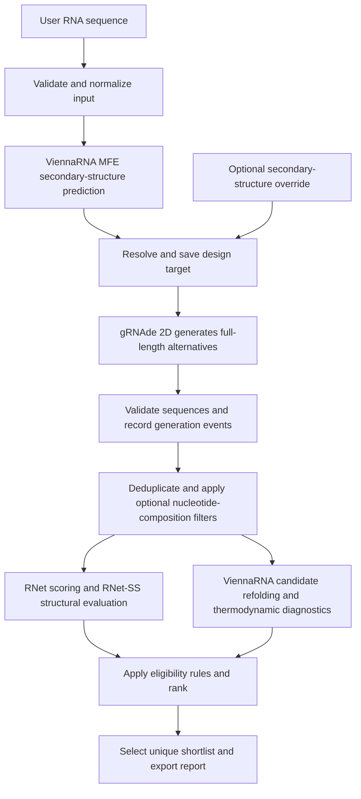

# RNA Sequence Design CLI: product requirements

Document version: 0.4 | Date: 2026-09-22 | Status: agreed initial scope; implementation details to validate

This document defines a new implementation. The supplied prototype was consulted for product context; its algorithms, model wrappers, architecture, and scientific assumptions are not implementation specifications. Scope reflects the user's clarifications: accept arbitrary supported RNA sequences, start with gRNAde, redesign the full sequence, run locally where practical, and add other models and region preservation later. Twort is an example input, not a product-specific dependency. Proposed numeric defaults remain adjustable until milestone M0.

## 1. Product objective

Build a command-line research tool that accepts a user-provided RNA sequence, uses ViennaRNA to predict its minimum-free-energy (MFE) secondary structure, passes that structure to gRNAde in 2D mode to generate alternative sequences, and evaluates the candidates to produce an auditable ranked shortlist. Sequence input alone must be sufficient for the default workflow. Add further pretrained RNA design models incrementally behind the same workflow.

**Initial workflow: input RNA -> ViennaRNA secondary-structure prediction -> gRNAde 2D generation -> RNet screening and candidate refolding -> ranked exports.**

The product is a general RNA design tool. It must not depend on Twort-specific sequence content, length, domains, motifs or structure files. Twort is one example and regression fixture. The intended result is a candidate library for experimental investigation; computational selection does not establish biological function.

Terminology: the **input sequence** (also called the reference or base sequence) is whichever sequence the user enters for that run. The **target structure** is its predicted structure by default. An optional **supplied target** means the user already has a structure annotation and explicitly chooses to use it instead of the default prediction. Supplying that annotation is never required for normal use.

The long-term workflow follows the presentation's sequence-generation diagram on slide 19. Slide 5 informs structural/composition analysis; slide 20's preservation controls belong to a later milestone. RNet-based screening comes from the supplied paper. See [source review and decisions](SOURCE_REVIEW.md) for the evidence and unresolved details.

## 2. Users and jobs

| User | Job | Successful outcome |
|---|---|---|
| Biology researcher | Enter an RNA sequence; optionally override its predicted target or later add preservation constraints | A readable configuration and shortlist with interpretable measurements |
| Computational researcher | Run model families under comparable conditions and inspect failures | Reproducible batches with complete model, input, and scoring provenance |
| Research engineer | Add or update a model without rewriting the product | An adapter that passes a documented compatibility contract |

The key job is: "Given this RNA and the structure I want to retain, generate different sequences and show me which have the strongest computational support for that structure."

## 3. Release scope

### Required for v0.1: gRNAde CLI

- A reusable Python core and CLI, with versioned configuration and result formats.
- One real gRNAde adapter using its documented 2D mode for the initial sequence-to-secondary-target workflow. Verify the compatible checkpoint and runtime in M0. Tertiary-structure conditioning is explicitly outside v0.1.
- Any canonical RNA input within documented model/predictor length limits. Automatically predict its secondary structure with ViennaRNA as the design target; an explicit secondary-structure override is optional.
- Full-sequence redesign, keeping reference length fixed. Every position is mutable. Distinct candidates must differ from the reference; no minimum mutation count is imposed by default.
- RNet screening, structural comparison, required sequence and dot-bracket Levenshtein distances from the original input, composition measurements, optional global C% filtering, and a unique ranked shortlist.
- Configurable batching, resumable execution, model readiness checks, and explicit handling of partial results.
- FASTA, CSV, JSON/JSONL, and a Markdown run report. Local execution is preferred; use the same CLI on a Runpod GPU host if local inference is unsupported or impractically slow. No server or UI is required.

### Subsequent CLI milestones

1. Add Struct2SeQ and compare both models under the shared evaluator.
2. Add RNA MPNN in a later 3D-input milestone with validated backbone-to-input mapping; optionally expose gRNAde 3D mode using that same mapping layer. This extension requires compatible backbone coordinates and is not a sequence-only feature.
3. Add fixed/mutable regions, per-position constraints, reference-preservation profiles, and richer diversity/composition selection.

The ordering is a product recommendation, not a dependency between the underlying models. Each new adapter is a separately testable release. v0.1 does not wait for all three families or 3D mapping.

### Deferred

Training or fine-tuning models; general RNA sequence-to-3D prediction; diffusion backbone generation; automated multigeneration optimization; variable-length/indel design; multiple interacting RNA design chains; direct prediction of m5C or other modified-nucleotide effects; synthesis ordering, barcode design, and laboratory automation; accounts, web dashboards, and cloud provisioning.

The first version generates and screens bounded candidate batches. Researchers can revise configurations and run new experiments. An automatic evolutionary feedback loop is a later feature.

## 4. General input contract and assumptions

| Item | Required behavior / assumption | Product implication |
|---|---|---|
| Input sequence | User supplies raw RNA text or single-record FASTA for each run | No built-in reference sequence, sequence whitelist or Twort-specific checks |
| Input length | Variable across runs, bounded by verified adapter and predictor capabilities | Preserve that run's input length in candidates; report unsupported lengths before generation |
| Input composition | Compute from the current input | No hardcoded baseline composition or biological thresholds |
| Target secondary structure | ViennaRNA MFE prediction from the current input, represented in dot-bracket notation, unless an override is supplied | No curated annotation or biology approval is required to use the default workflow |
| Crystal structure | Optional future input for 3D-capable adapters | Not required for the initial sequence-only gRNAde workflow |
| Mutable region | User confirmed full-sequence redesign first | Every input position is mutable in v0.1; partial preservation is deferred |
| Chemistry | Initial models operate on canonical RNA | Initial scope is unmodified A/C/G/U RNA |
| Compute | User prefers local execution, with Runpod if CUDA is needed | Test the actual local CPU/runtime first; benchmark end-to-end inference before choosing the default host |

The supplied Twort sequence is 282 nt and is one useful compatibility case. The paper's longer challenge targets extend to 240 nt; that range is neither a universal software limit nor evidence for arbitrary-length operation. Test multiple unrelated RNA inputs and representative lengths, including the user's Twort example, then publish the verified limits. Keep example-specific sequence statistics and the 1Y0Q mapping issue in the source review and test fixtures.

## 5. Scientific contract

### What "similar structure" means

The initial CLI measures agreement with the input sequence's ViennaRNA-predicted secondary structure. This is a prediction-based design target, not a claim to know the input's experimental fold. An explicit secondary-structure override may include pseudoknots when supported by the generator and evaluation stack, but the default ViennaRNA MFE prediction does not generate them. In later releases, a supplied backbone is an additional design input for compatible generators. Neither low secondary-structure distance nor a high RNet score demonstrates a matching 3D fold or retained catalytic activity.

Keep three objects separate in every run: the reference's predicted fold, the chosen design target, and each candidate's predicted fold. Selecting an explicit target never overwrites or relabels the reference prediction. "Same structure" is the design objective; the CLI reports measured predicted agreement and does not guarantee physical identity.

### What "RNet score" means

The common evaluation stage uses a pinned RibonanzaNet chemical-reactivity predictor and a pinned OpenKnot scoring definition to compare predicted reactivities with the target. Store it as `predicted_openknot_score`, with the formula/version, target, evaluated positions, and checkpoint identity. Do not assume that every upstream field named `openknot_score` implements the same metric.

RibonanzaNet-SS is a separate structural prediction capability used to obtain predicted base pairs. Store its checkpoint and decoding method separately. A reactivity profile alone is not a base-pair map. The official projects document these separate inference uses: [RibonanzaNet](https://github.com/Shujun-He/RibonanzaNet), [OpenKnotScorePipeline](https://github.com/eternagame/OpenKnotScorePipeline).

A common evaluation stage makes results comparable; it is not necessarily independent validation. In particular, the paper describes Struct2SeQ as trained and guided using RNet. Report known scorer use during model training or candidate search. Do not claim an unbiased model leaderboard from RNet scores alone.

### Target and construct integrity

Secondary-target integrity applies to v0.1. Backbone mapping and fixed-region rules apply when those capabilities are added.

- Use 1-based, inclusive reference coordinates in all user-facing files. Store any conversion explicitly.
- Parse extended dot-bracket notation into a canonical base-pair set. Detect pseudoknots from crossing pairs, not merely from the presence of square brackets.
- The secondary-target representation supports one pairing partner per nucleotide. Tertiary contacts and base triples remain separate annotations.
- Reject malformed structures, unequal target/sequence lengths, invalid masks, and conflicting constraints before inference.
- Preserve crystal residue identifiers, insertion codes, chain IDs, missing residues, and construct differences in a mapping report. Do not silently crop, pad coordinates, invent unresolved atoms, or renumber away gaps.
- Backbone-only design of a mapped segment with fixed flanks is allowed only if the adapter supports it and the experiment explicitly defines the segment and context. Evaluate the assembled full construct; document which positions lacked structural conditioning.
- Keep cross-region base pairs when freezing a region. Preserving its sequence does not guarantee preserving its fold.
- A standard ViennaRNA MFE fold does not describe pseudoknots. For a pseudoknotted target, its outputs are explicitly limited diagnostics; they cannot be the sole measure of target recovery.

## 6. Initial CLI workflow

The first release operates on secondary structure only. The following diagram shows the complete initial workflow; additional models, tertiary structures and fixed-region controls belong to subsequent milestones.



1. Validate the input sequence and the selected runtimes before expensive execution. Check that the full input length is supported.
2. Fold the input with ViennaRNA at the configured physical temperature. Save its MFE structure, energy, engine version and settings. Use its dot-bracket structure as the default design target; an explicit override changes the design target while retaining the reference prediction.
3. Save the resolved target and configuration. Generate the requested full-length proposals using gRNAde in 2D mode, allowing every sequence position to change.
4. Preserve generation provenance, validate proposals, deduplicate sequences and apply any optional nucleotide-composition filters the user enabled, such as a maximum C percentage. These filters are off by default.
5. Score unique eligible candidates against the saved target with RNet. Use RNet-SS for pair-level comparison and refold each candidate independently with ViennaRNA for structural and thermodynamic diagnostics. Report sequence Levenshtein distance from the original RNA and dot-bracket Levenshtein distance from the original RNA's ViennaRNA fold. Evaluate the input sequence as a separate control.
6. Apply configured quality gates, rank candidates, and select up to the requested shortlist size.
7. Export results and a report explaining counts, exclusions, failures, and limitations.

Generation attempts to satisfy the target; evaluation measures whether each generated sequence is predicted to do so. Candidate refolding must not be forced to reproduce the target. The saved target stays fixed throughout the run and on resume.

## 7. Functional requirements

### FR-01: Inputs and configuration - v0.1

Accept a raw RNA text file or a single-record FASTA, optional extended dot-bracket file, and a YAML experiment configuration. PDB/mmCIF and chain/mapping inputs arrive with the 3D milestone. Normalize case and whitespace while saving original bytes and the normalized sequence. Reject ambiguous bases and DNA `T`; an explicit conversion option can be added later.

An experiment records its target source: `reference_mfe` by default, or `provided` when a target file is explicitly supplied. The initial predictor is ViennaRNA MFE: input sequence -> predicted secondary structure in dot-bracket notation -> gRNAde 2D sequence generation -> candidate evaluation. Its pseudoknot limitations must be clear; a future predictor can use a separately named mode. The user need not choose a target-source setting for ordinary sequence-only use. An explicit target file switches to `provided`; contradictory explicit source settings are errors. Record canonical RNA chemistry, model, budgets, evaluation settings, eligibility rules and output location. The schema later extends to regions and profiles. Unknown keys, unsupported future controls and ambiguous FASTA records are errors.

### FR-02: Constraints and experiment context - global C% in v0.1; region controls later

V0.1 treats the submitted sequence as one full construct. All positions may change. Global C% filtering is optional and disabled by default; report composition and reference distance regardless of whether filtering is enabled. Do not inherit the prototype's sequence bias or region assumptions.

In the preservation milestone, support fixed positions/ranges, named mutable ranges, allowed bases per position, region-specific C% limits, optional U%/GC% limits, and reference-distance ranges. Unspecified limits are disabled. Reject contradictory masks and impossible fixed-base composition bounds before generation where determinable.

Support annotated fixed flanks/exon context within the submitted full sequence; do not infer them from sequence content. Composition scope is explicit (`full_construct` or a named region). Positions outside configured mutable regions are fixed. If no regions are supplied, all positions are mutable, and the execution plan says so.

Every accepted candidate must satisfy hard sequence constraints regardless of adapter behavior. Native constrained sampling is preferred; bounded rejection sampling is allowed and labeled. Do not patch fixed bases into a generated sequence and preserve its old scores. Any explicit later editing creates a new candidate requiring full reevaluation.

### FR-03: Model registry and adapters - gRNAde in v0.1; other adapters later

`models list` and `doctor` report exact variant, source revision, checkpoint hash, license/access prerequisites, supported inputs and constraints, installed runtime, device compatibility, and tested length range. Capability states distinguish documented support, locally verified support, and unavailable features.

| Family | Planned adapter | Required input and integration boundary |
|---|---|---|
| gRNAde | 2D mode in v0.1; compatible checkpoint verified during M0 | ViennaRNA-derived or explicitly supplied secondary target. 3D mode requires a compatible backbone and is deferred. [Guide](https://github.com/chaitjo/geometric-rna-design/blob/main/docs/creating_designs.md) |
| Struct2SeQ | Pinned publicly available checkpoint; exact variant in manifest | Secondary target and supported reference conditioning; SHAPE-related options only if their semantics are verified. A crystal file is not assumed to be a native input. [Repository](https://github.com/Shujun-He/Struct2SeQ) |
| RNA MPNN | NA-MPNN fixed-backbone adapter | Mapped RNA backbone. This is the proposed implementation of the slide's MPNN family, not a claim to reproduce every paper variant. [Repository](https://github.com/baker-laboratory/NA-MPNN) |

MPNN-RFdiff and codesign-RFdiff are different pipelines and are outside the planned releases. A model that cannot consume a requested input must report that fact. Never substitute another model or a random sequence generator under its name. Any adaptation of upstream research code must be documented and validated independently of the supplied prototype.

### FR-04: Sequence-preservation profiles - later milestone

Implement `preserve`, `balanced`, and `explore` as experiment policies, corresponding to high, medium, and low preference for reference sequence conservation. All three retain the structural design objective and hard constraints.

There is no promised universal numeric "sequence versus structure weight." Each adapter exposes verified native controls and the resolved configuration records their meanings. Use calibrated reference-bias parameters where available. If a model lacks such a control, an explicitly labeled selection-only policy may stratify a shared pool by reference distance. Report the shared-pool relationship; never present it as three distinct native conditioning runs.

The preservation milestone must determine whether the planned profile behavior is feasible for each adapter. Profile calibration reports sequence-distance distributions, structural scores, and unique yield across multiple seeds. Do not guarantee that a stronger nominal bias will produce a particular score or identical behavior across models. V0.1 has one full-redesign policy without a reference-preservation knob.

### FR-05: Generation budgets and counts - v0.1

Proposed v0.1 campaign default: 1,000 returned gRNAde proposals; smoke preset: 10. These are proposals, not a promise of 1,000 unique passing candidates. With future profiles, counts become explicit per model/profile; a three-family, three-profile campaign at 1,000 each would total 9,000 only when all combinations generate separate pools.

Specify returned-proposal quota, generation-attempt cap, wall-time cap, batch size, master seed, and device. Record native internal search effort when available; do not equate one returned Struct2SeQ result with one internal search proposal. Shared-pool profile selection must disclose its actual generation budget.

The runner stops at its configured bounds. It records requested, attempted, returned, invalid, duplicate, constraint-passing, scored, eligible, and selected counts per model/profile. Partial or zero yield is a valid scientific outcome, not permission to relax constraints. The reference control does not count toward generated or novel candidates.

### FR-06: Metrics - core structural/composition metrics in v0.1

V0.1 requires RNet score, RNet-SS pair metrics, sequence Levenshtein distance, dot-bracket Levenshtein distance, identity/Hamming distance, C%/U%/GC%, MFE, and MFE frequency. Both Levenshtein measurements are explicitly requested first-release outputs and must be reported separately.

| Metric | Definition and interpretation |
|---|---|
| Sequence identity / Hamming distance | For equal-length candidates, positional identity and number of substitutions relative to the reference; higher identity means greater conservation |
| Sequence Levenshtein distance | Minimum unit-cost insertions, deletions and substitutions between a generated RNA sequence and the original input RNA; lower means closer nucleotide strings; zero means identical strings |
| C%, U%, GC% | Counts divided by the explicitly named sequence/region length, multiplied by 100; filter on unrounded values |
| Predicted OpenKnot score | Versioned upstream scoring definition applied to RNet-predicted reactivities; higher is better only under that defined scale |
| Base-pair precision, recall, F1 | Agreement between predicted and target pair sets; F1 = 2TP/(2TP+FP+FN), independent of bracket glyph assignment |
| Base-pair distance | Size of the symmetric difference between predicted and target pair sets |
| Crossed-pair recovery | Recall for target pairs participating in pseudoknots; null when the target has no crossed pairs |
| Dot-bracket Levenshtein distance | Minimum unit-cost character edits between the candidate's independently predicted ViennaRNA MFE dot-bracket string and the original input's ViennaRNA MFE dot-bracket string; lower means closer structure strings; zero means identical dot-bracket strings |
| MFE and MFE frequency | ViennaRNA diagnostic energy in kcal/mol and ensemble frequency in [0,1], with temperature, energy settings, and model scope recorded |
| Model-native score | Optional diagnostic kept in a model-specific namespace; not directly compared across families |

The Levenshtein comparison contract is:

- `sequence_levenshtein_to_input = LD(candidate_sequence, input_sequence)`.
- `mfe_structure_levenshtein_to_input = LD(candidate_mfe_dot_bracket, input_mfe_dot_bracket)`.
- `LD` is standard string Levenshtein distance: insertion=1, deletion=1, substitution=1 and matching characters=0. Transposition is not a separate operation. Report the raw nonnegative integer distance, not a percentage or a normalized score. [Definition](https://xlinux.nist.gov/dads/HTML/Levenshtein.html)
- Normalize RNA case/whitespace before comparison. Use the two ViennaRNA MFE structures in standard `.` / `(` / `)` notation, computed with the same physical folding settings and engine version. Store both compared strings and their provenance.
- These metrics always compare with the original input and its predicted fold. An explicit design-target override must not silently change their reference. If a separate distance to that override is added, it needs a distinct field name and comparison reference.
- Sequence distance remains available when folding or RNet scoring fails. Structural distance is null with a recorded reason when either ViennaRNA fold is unavailable; it must never fall back to sequence distance or zero.
- Equal-length sequences can have different Hamming and Levenshtein distances because Levenshtein allows insertions/deletions in the comparison. This does not enable variable-length generation. Dot-bracket edit distance measures string similarity and supplements the pair-set metrics; it does not replace them or measure tertiary structure.

Both distances are descriptive outputs by default. Adding them does not enable a new rejection threshold or change the RNet-based ranking. A candidate may have a large sequence distance and a small structural distance, consistent with the project's objective.

For pair metrics, both-empty pair sets have F1=1 and distance=0; exactly one empty set has F1=0. Report precision/recall as null when their denominator is zero, with that convention documented. Exclude unmapped or unsupported positions only through an explicit evaluation mask shared across comparable candidates.

The MFE structure's ensemble frequency is not automatically the target structure's frequency. A high frequency for an incorrect fold is not success. Physical folding temperature and neural sampling temperature are different settings. [ViennaRNA RNAfold documentation](https://www.tbi.univie.ac.at/RNA/ViennaRNA/doc/html/man/RNAfold.html)

Every metric has a status (`ok`, `failed`, `not_applicable`, or `unsupported`) and versioned provenance. Missing values remain null, never zero. Failure of an auxiliary metric does not erase sequences or successful scores.

### FR-07: Eligibility, ranking, and diversity - unique ranking in v0.1; diversity policies later

Apply hard sequence/composition constraints before expensive screening when possible. After screening, apply only explicitly configured structural/score gates. Default rank order among eligible candidates: predicted OpenKnot score descending, then RNet-SS base-pair F1 descending, then stable candidate ID for ties. Both primary evaluations must succeed for the default shortlist; failures remain available in exports.

The paper's experimental score cutoff of 90 is not an automatic acceptance threshold for this application. Biological thresholds must be chosen and documented for this experiment. A run without structural thresholds reports "top-ranked predictions; no structural pass threshold configured."

Default shortlist size: up to 100 unique, non-reference sequences. V0.1 selects from the ranked list. Later add a minimum pairwise Hamming distance using deterministic greedy selection, per-model/profile rankings, and optional group quotas. If quotas conflict with uniqueness or diversity, return fewer sequences and explain the shortfall; never silently lower a gate.

### FR-08: Durable runs and recovery - v0.1

Persist an immutable resolved configuration, input snapshots and hashes, append-only events, unique candidate records, generation events, and versioned evaluation results. Use checkpointed batches and atomic writes. A resumed run reuses completed compatible stages and preserves the original candidate IDs.

Cache identity includes sequence, full context, target, evaluation mask, predictor/checkpoint, decoding/scoring version, and relevant parameters. Changed scores or filters create a new evaluation/selection revision. Changed generation inputs require a new run. Never reuse scores solely because two candidate names match.

Validate the requested adapter before expensive execution. Missing mandatory capabilities prevent the run. Mid-run failures preserve successful work. In the multiple-model milestone, an explicit `--allow-partial-models` option permits supported subsets and labels the campaign partial; finish independent queued work when possible.

### FR-09: Outputs and inspection - v0.1

Export the reference control; full candidate table; generation provenance; rejection reasons; predicted structures/reactivities; ranked eligible table; selected FASTA/CSV; and a run report. Candidate, ranked and selected CSV tables include separate `sequence_levenshtein_to_input` and `mfe_structure_levenshtein_to_input` columns; detailed JSON/JSONL records include their status, comparator identity, metric version and fold provenance. The report explains both distances and states input/target provenance, actual model coverage, profile semantics, score definitions, budget use, exclusion counts, model/profile distributions, and deviations from the plan.

Deduplicate by normalized full sequence within a construct context. One unique candidate can have multiple generation events across models/profiles. Do not discard those events or award duplicate shortlist slots. CSV uses stable identifiers that join to JSONL for nested metadata.

### FR-10: Reevaluate without regeneration - reselection in v0.1; external imports later

Allow re-selection from stored scores in v0.1. Add scoring of an external candidate FASTA in the second-model milestone. Preserve source IDs and provenance for imported candidates, identifying them as imported rather than model-generated. Reevaluation uses a new immutable evaluation revision and does not silently overwrite historical reports.

## 8. Proposed CLI contract

These commands specify intended behavior; the CLI has not been implemented. `rna-design` is a working command name. A sequence file alone is enough to start a run with recorded defaults.

```bash
rna-design run --sequence input.fasta --out runs/design-001
rna-design init --sequence input.fasta --output experiment.yaml
rna-design models list
rna-design doctor --config experiment.yaml
rna-design validate --config experiment.yaml
rna-design run --config experiment.yaml --dry-run
rna-design run --config experiment.yaml --out runs/design-002
rna-design status runs/design-001
rna-design resume runs/design-001
rna-design select runs/design-001 --top-k 100 --out selections/review-001
rna-design export runs/design-001 --formats fasta,csv,json --out exports/design-001
```

`run --sequence` predicts the target automatically and saves a resolved configuration; it does not require a preexisting config or structure file. `init` writes an editable starter configuration with target prediction already selected. An optional `--target target.dbn` overrides the predicted design target and is recorded as `provided`. `validate` is lightweight. `doctor` checks environments, weights and capabilities; real inference tests use an explicit smoke option. A dry run enumerates input consumption, unsupported features, the full-redesign policy, proposal totals, output paths, and any available hardware estimate without generating candidates. Later add `rna-design score` for external candidate FASTA input and model/profile comparisons.

Progress and diagnostic logs go to stderr; machine-readable output is available through `--json`. Exit codes: 0=successful requested operation, 2=invalid input/configuration, 3=missing dependency or unsupported capability, 4=partial/failed execution, 130=interrupted. A fully executed run with no eligible candidates exits 0 with an explicit `completed_no_candidates` status; a budget-exhausted generation shortfall exits 4. No interactive prompts during normal batch execution.

## 9. Architecture and data contracts

Use a lightweight Python orchestrator with isolated model environments or containers, rather than forcing all research dependencies into one runtime. Keep CLI, experiment schemas, model adapters, evaluation, filtering, storage, and reporting as separate modules. A future UI can call the same core or consume its run artifacts.

Start with filesystem run directories; add an index only if demonstrated necessary. No PostgreSQL, message broker, REST API, or distributed scheduler is required for v0.1. Jobs run on the host where the CLI is invoked. Prefer local CPU execution if the complete model/scorer stack supports it at acceptable speed; do not assume CUDA-only dependencies can run on Apple hardware. If CUDA is needed, document running the same CLI on a Runpod GPU pod and copying the run directory back. Automatic provisioning and a transparent remote scheduler are deferred.

| Record | Minimum contents |
|---|---|
| Experiment | Schema version, construct, target source, constraints, model, budgets, evaluation/selection settings; mapping, regions and profiles added later |
| Run | Immutable config, input hashes, software/environment versions, start/end times, device, status, resolved plan, parent run if any |
| Candidate | Stable content identity, canonical sequence, construct ID, length, reference relationship |
| Generation event | Candidate ID, model/variant/checkpoint, profile, native controls, seed, batch/ordinal, parent provenance, internal effort if available |
| Evaluation | Candidate and target IDs, metric names/versions, values/statuses, predictor provenance, context/mask, timestamps |
| Selection | Evaluation revision, gates, ranking policy, diversity/quotas, selected IDs, reasons for exclusions |

## 10. Nonfunctional requirements

- Reproducibility: record source revisions, artifact hashes, resolved controls, seeds, runtime and hardware. Repeated runs under a deterministic supported configuration reproduce outputs; document residual nondeterminism instead of promising cross-device bitwise identity.
- Scale: process a 1,000-proposal gRNAde campaign in bounded batches on the chosen local or GPU host, with smoke runs across representative input lengths and unrelated sequences. Establish runtime/VRAM/RAM baselines in M0 and measure the release campaign in M3. Later validate a 9,000-proposal multi-profile campaign. No unsupported throughput promise is a release requirement.
- Recovery: interruption loses no completed committed batch. An interrupted batch may be retried; deterministic event IDs prevent duplicate committed records.
- Installation: documented reproducible setup and readiness diagnostics for each adapter. Model downloads are explicit setup actions with disk-size/access information; normal validation does not trigger downloads or GPU provisioning.
- Portability: lightweight commands work without GPU libraries; full inference is supported only on tested configurations. A Mac interface does not imply all models can run on Apple GPU hardware.
- Data control: no automatic upload of sequences, structures, or results. Local run artifacts are self-contained and exportable.
- Maintainability: meaningful tests cover coordinate mapping, scientific metrics, adapter contracts, failure recovery, and a real end-to-end run. Test doubles are labeled and cannot emit production scientific results.

## 11. Acceptance and release gates

V0.1 gates apply to gRNAde, full-sequence redesign, and the shared evaluator. Backbone, additional-model, and preservation acceptance gates activate in their respective milestones.

| Gate | Acceptance evidence |
|---|---|
| Input integrity | Multiple unrelated RNA sequences of different lengths round-trip; malformed inputs and unsupported lengths are rejected; no silent length changes |
| Sequence-only workflow | A new valid input FASTA works without a supplied structure, curated annotations, Twort assets or source-code changes |
| Secondary-target handoff | Without an override, the saved ViennaRNA dot-bracket prediction is exactly the target passed to gRNAde 2D and used for evaluation; its identity remains unchanged on resume |
| Initial mode boundary | v0.1 does not request or consume PDB/mmCIF coordinates; unsupported tertiary-structure options fail explicitly rather than being silently ignored |
| Real model coverage | gRNAde generates real sequences for a representative fixture set, including the Twort example, with verified weights and provenance; later repeat for each added family |
| Constraint correctness | 100% of shortlisted sequences satisfy all configured hard sequence, composition, and selection rules |
| Evaluation fidelity | Shared scores reproduce chosen upstream fixtures within declared tolerances; pseudoknot pair metrics pass hand-checkable fixtures |
| Requested distance outputs | Sequence and MFE dot-bracket Levenshtein distances match hand-checkable cases, use the original input as their reference even with a target override, remain distinct in exports, and handle fold failures without fabricated values |
| Policy transparency | Every position is mutable in v0.1, with no hidden reference bias; later profiles declare their actual mechanism |
| Recovery | An interrupted campaign resumes without losing committed candidates or duplicating evaluation work |
| Useful handoff | A biology reviewer can trace each shortlisted sequence to its inputs, model events, scores and selection reasons |
| Campaign completion | A bounded 1,000-proposal gRNAde campaign produces a report accounting for every returned proposal, including zero-yield/partial cases |

Scientific utility is a separate assessment: compare the reference, per-family candidates and combined shortlist on matched evaluation settings; report diversity and constraint yield. Experimental structure/function confirmation is outside software acceptance. High proxy scores alone do not prove generalization or useful splicing.

## 12. Implementation decisions to resolve in M0

1. Verify the ViennaRNA MFE integration and record its version, physical temperature and energy settings. The selected workflow is settled: ViennaRNA predicts the default secondary target, which conditions gRNAde 2D generation; an explicit secondary-target override remains optional.
2. Establish and document supported input-length ranges for gRNAde, the target predictor and both evaluators using representative fixtures; include Twort as one example, not the only acceptance case.
3. Benchmark the actual local stack and agree what runtime is acceptable before deciding whether a campaign needs Runpod. GPU rental cost is not estimated without a selected machine and measured workload.
4. Verify model/checkpoint identities and the exact common scoring definition. No per-sequence biological annotations are required for the default workflow.
5. Later: validate any user-provided backbone against that run's input, and obtain user-defined region boundaries when partial preservation is requested. The included 1Y0Q mismatch is a useful mapping test case.

The interface must work for a new supported RNA sequence without modifying code, selecting a special sequence preset, or supplying an experimental structure.
